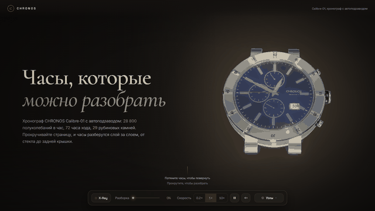
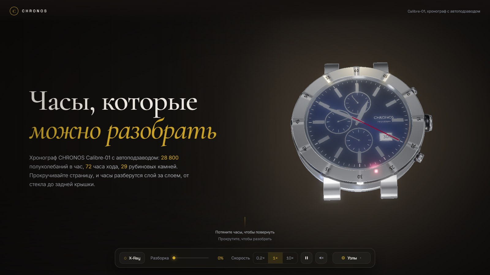
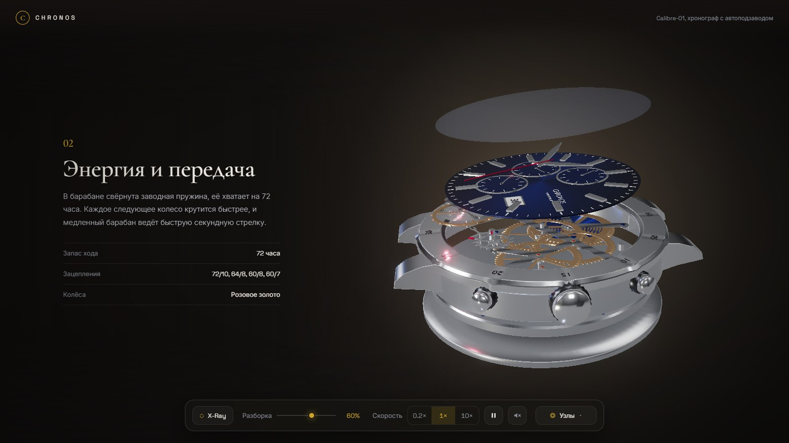
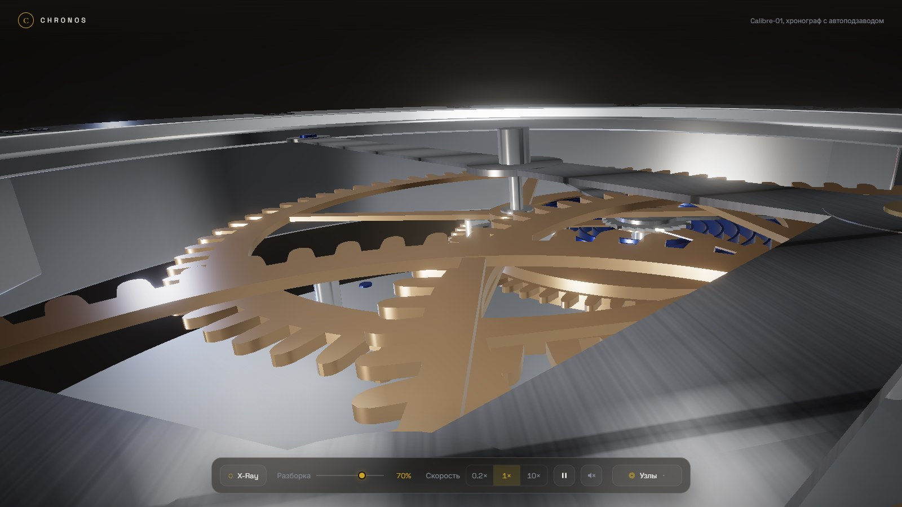
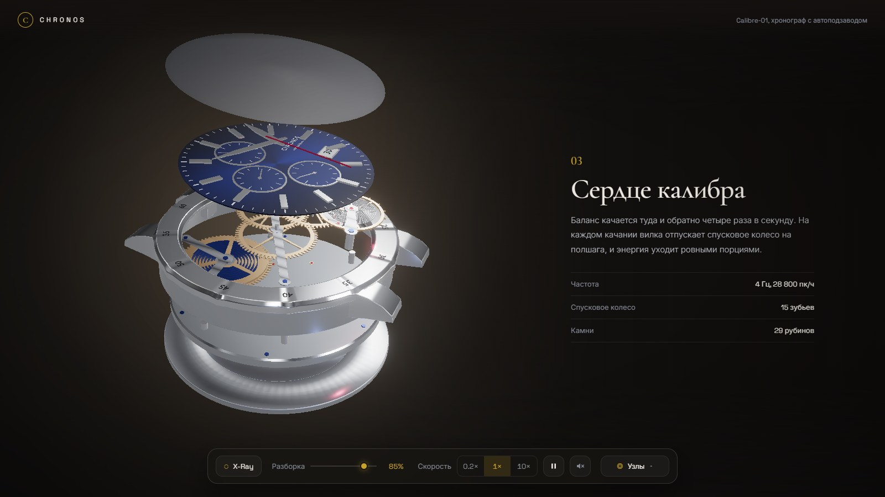
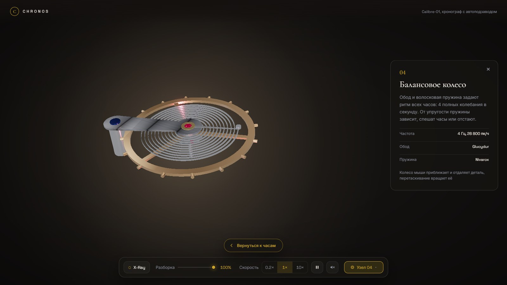
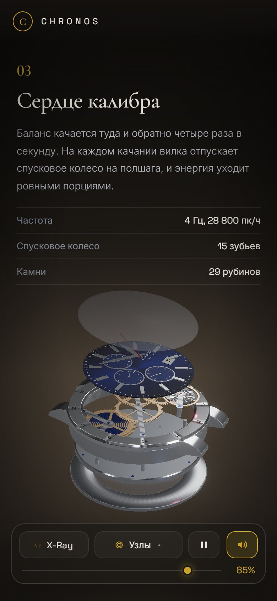
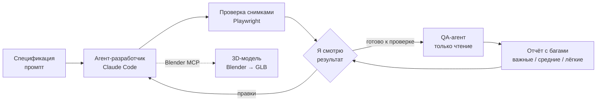

# CHRONOS // CALIBRE-01

Интерактивный 3D-сайт механических часов. При прокрутке часы разбираются на 10 слоёв, камера облетает их и пролетает сквозь механизм, а любую деталь можно приблизить и рассмотреть отдельно.

**[Открыть сайт →](https://sckrilbot.github.io/3d-watch-website/)**



Проект сделан в связке с ИИ-агентами: 3D-модель, код сайта и проверки писали агенты, а я ставил задачи, принимал решения по дизайну и принимал результат. Ниже — как это было устроено.

---

## Что умеет сайт

- **Разборка по прокрутке.** 10 слоёв, от сапфирового стекла до задней крышки, расходятся по оси с задержкой между слоями, как на взрыв-схеме.
- **Пролёт камеры.** Камера облетает часы по сплайну, а между второй и третьей секцией сама пролетает сквозь разобранный механизм и разворачивается на него.
- **Живой механизм.** Колёса крутятся по реальным передаточным числам (72/10, 64/8, 60/8, 60/7), баланс качается, вилка отпускает спусковое колесо на полшага, стрелки показывают текущее время.
- **Узлы.** Барабан, колёсную передачу, спуск и баланс можно выбрать из списка: камера летит к детали, остальные слои растворяются, колесо мыши приближает.
- **Звук без аудиофайлов.** Трещотка при прокрутке, щелчки слоёв и шорох пролёта синтезируются в браузере через Web Audio.
- **Вращение мышью** на первом экране, X-Ray, пауза и скорость механизма.
- **Адаптивность и доступность.** Отдельная раскладка для телефона и планшета, управление с клавиатуры, `prefers-reduced-motion`.

| | | |
|---|---|---|
|  |  |  |
| Первый экран | Разборка, секция 02 | Пролёт сквозь механизм |
|  |  |  |
| Секция 03 | Узел «Балансовое колесо» | Телефон |

---

## Как я работал с ИИ-агентами

Основной инструмент — **Claude Code**. Моя роль — постановщик задачи, арт-директор и приёмка: я формулировал, что нужно, смотрел результат на скриншотах, принимал или отклонял решения. Агенты писали код, строили модель и проверяли друг друга.



### 1. Спецификации вместо разговоров

Проект начался с трёх ТЗ для агентов: модель в Blender, экспорт GLB и сайт. Каждое построено одинаково: роль исполнителя, контекст, требования, результат и критерии приёмки. В них зафиксировано то, на что опирается код: точные имена 10 слоёв, ось сборки, точки вращения деталей. Благодаря этому модель можно было пересобирать много раз, не ломая сайт.

→ [ТЗ 1: модель](docs/process/prompts/01-blender-model.md) · [ТЗ 2: экспорт](docs/process/prompts/02-export-glb.md) · [ТЗ 3: сайт](docs/process/prompts/03-website.md)
### 2. 3D-модель руками агента

Модель целиком построена агентом через **Blender MCP**: агент писал Python-скрипты для Blender и запускал их в живой сцене. Механизм не нарисован, а сгенерирован: передаточные числа, число зубьев и межосевые расстояния считаются в скрипте, поэтому зубья соседних колёс действительно входят друг в друга. Ориентиром для корпуса было фото реальных часов, для разборки — видео-референс.

### 3. Независимый QA-агент, которому нельзя чинить

Самое полезное решение в проекте. Я завёл отдельного агента-ревьюера с правилами:

- он видит проект «впервые» и не знает, что как задумано;
- проверяет код и живой сайт в браузере: прокрутку вперёд и назад, все кнопки, размеры экрана, консоль;
- **ничего не меняет**: это обеспечивает не просьба в промпте, а хук, который блокирует любую запись, кроме файла отчёта;
- каждая находка должна быть воспроизведена или подтверждена строкой кода, а непроверенное честно выносится в отдельный раздел.

Так разработчик и проверяющий разделены, и агент не принимает работу сам у себя.

| Раунд | Важные | Средние | Лёгкие | Что нашёл, например |
|---|:-:|:-:|:-:|---|
| [1](docs/process/qa-reports/QA_2026-10-16_1247.md) | 6 | 9 | 10 | колесо мыши зумило камеру вместо прокрутки |
| [2](docs/process/qa-reports/QA_2026-10-16_1951.md) | 1 | 3 | 6 | страницу можно было сдвинуть полосой прокрутки при открытом узле |
| [3](docs/process/qa-reports/QA_2026-10-16_2218.md) | 2 | 5 | 5 | выбор узла во время пролёта «застревал» внутри часов |

После каждого раунда баги исправлялись по серьёзности, а следующий раунд сначала перепроверял старые.

→ [описание агента](docs/process/agent/qa-reviewer.md) · [хук «только отчёты»](docs/process/agent/reports-only.cjs)

### 4. Проверка снимками, а не «вроде работает»

Агент не может посмотреть на экран, поэтому каждое изменение проверялось скриптами на **Playwright**: они открывают сайт в headless Chrome, проходят сценарий и сохраняют скриншоты на десктопе, планшете и телефоне. Для сложных багов скрипт проверял конкретное состояние: что страница не сдвинулась, что пролёт доехал до нужной карточки, что звук сработал нужное число раз. Где важна точность, замерялись реальные пиксели: так нашёлся источник пересвета — блик стекла, а не свет сцены.

### 5. Память между сессиями

Длинный проект не помещается в одну сессию. Агент вёл журнал `start.md`: что сделано, почему, какие решения приняты и **что не возвращать** (например, «шкалу глубины пробовали и убрали — не предлагать снова»). Каждая новая сессия начиналась с чтения журнала, а не с объяснений с нуля.

### 6. Скиллы и чужое мнение — но решаю я

Для дизайна подключён скилл **frontend-design**: агент разобрал сайт по его принципам и нашёл шаблонные приёмы. Часть советов я принял (подписи без капса, тексты без карточек, палитра от самих часов), часть отклонил после того, как увидел вживую: золотые акценты вернул, а предложенную шкалу глубины убрал.

### 7. Модель под задачу

Простые вопросы и разбор планов — на быстрой модели, реализация и сложная отладка (камера, пролёт, гонки состояний) — на самой сильной. Ревью — отдельным агентом.

### Что я из этого вынес

- Агенту нужна проверяемая цель: «чтобы не прыгало» плохо работает, «покажи 9 кадров отрезка» — хорошо.
- Проверяющий должен быть отдельным агентом с запретом на правки, закреплённым технически.
- Решения стоит записывать сразу, вместе с причиной — иначе следующая сессия их отменит.
- Последнее слово по вкусу и UX — за человеком, который смотрит на живой сайт.

---

## Технологии

| | |
|---|---|
| 3D и рендер | Three.js: GLTFLoader, PBR-материалы, RoomEnvironment, EffectComposer + UnrealBloom, ACES tone mapping |
| Анимация | GSAP ScrollTrigger, сплайновая камера (Catmull-Rom), `setViewOffset` для композиции рядом с текстом |
| Звук | Web Audio API, синтез без файлов |
| Модель | Blender, генерация через Python (`bpy`) по Blender MCP, экспорт в GLB |
| Вёрстка | HTML, CSS, без фреймворков и сборщика; шрифты и библиотеки лежат локально |
| Проверка | Playwright (headless Chrome), отдельный QA-агент |
| ИИ | Claude Code, субагент, хуки, скилл frontend-design, Blender MCP |

## Запуск локально

Сборка не нужна, достаточно любого статического сервера:

```bash
python -m http.server 8765
```

Откройте <http://127.0.0.1:8765/>. Параметр `?enter` пропускает экран выбора звука, `?debug` открывает внутреннее состояние в консоли.

## Структура

```
index.html          разметка и секции
css/styles.css      стили
js/main.js          сцена, камера, разборка, узлы, звук
assets/             модель watch_calibre.glb
vendor/             Three.js, GSAP, шрифты (без CDN)
docs/process/       промпты-ТЗ, QA-агент, хук, отчёты проверок
docs/media/         картинки для этого README
```
